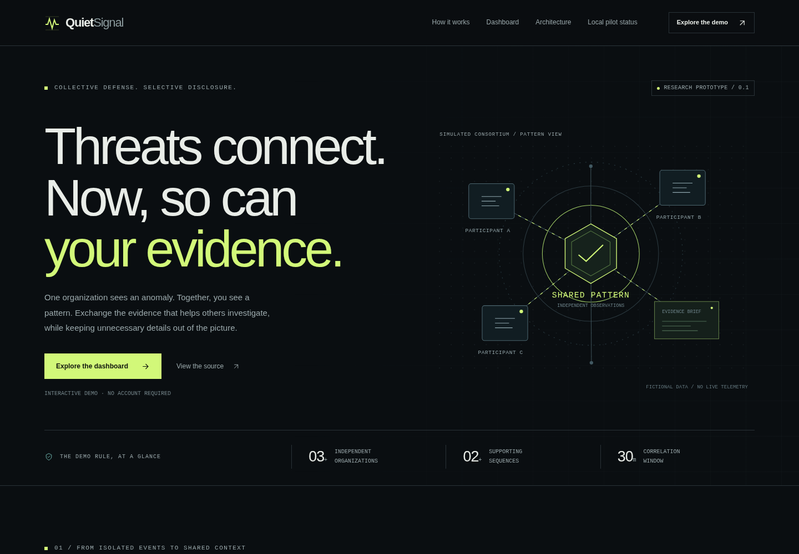
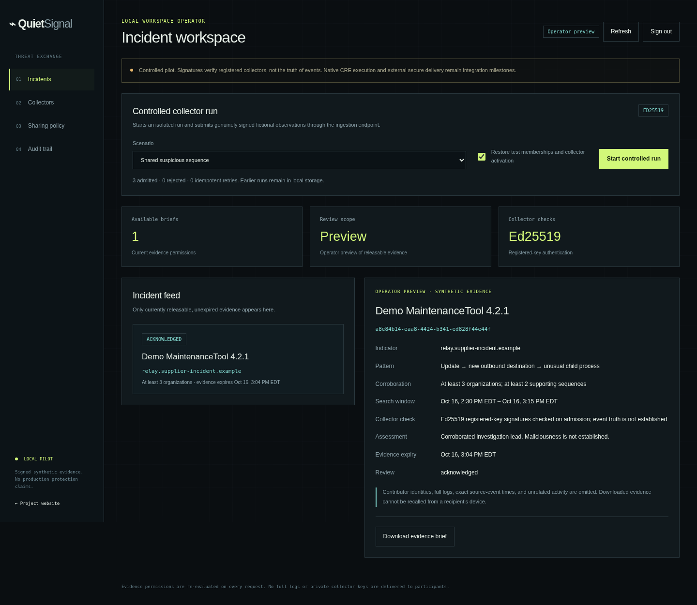
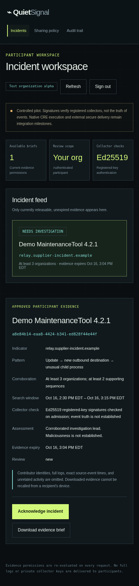
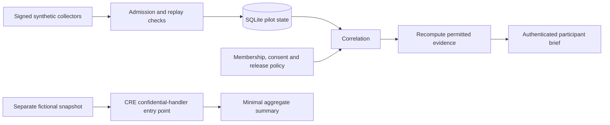

# QuietSignal

**Share enough threat evidence to investigate a shared supplier incident—without forwarding everyone's logs.**

[](https://github.com/Angelnycc/QuietSignal/actions/workflows/ci.yml)

[Explore the interactive website](https://quietsignal.netlify.app/) · [GitHub Pages mirror](https://angelnycc.github.io/QuietSignal/) · [Architecture](docs/architecture.md) · [Security model](docs/security-model.md) · [Validation evidence](docs/validation.md)



QuietSignal is a cybersecurity portfolio project exploring selective threat-evidence sharing across organizations. It combines a deterministic correlation/disclosure engine, an authenticated local incident workspace, signed synthetic collectors, persistent state and a Chainlink CRE confidential-workflow entry point.

**Current scope:** the public website demonstrates fictional scenarios. The working persistent backend runs locally. CRE TypeScript/WASM compilation and mock-handler tests pass; native CRE execution and deployed enclave guarantees remain unvalidated. No real-device monitoring, production threat verdicts, ZK proof, ACE, CCIP or firewall enforcement is claimed.

## The problem

One company sees an unfamiliar connection after updating a shared software supplier. That alone may be harmless. Other organizations seeing the same supplier version, destination and unusual process sequence could make it worth investigating—but exchanging full logs exposes employee information, internal infrastructure and unrelated business activity.

QuietSignal tests a narrower approach: correlate scoped observations, then release an explicitly approved evidence brief only when the permitted contributions support it. Recipients get an indicator, relevant software/version, sanitized sequence, coarse search window, corroboration thresholds and limitations. They do not get contributor identities, full logs, credentials or unrelated activity.

A warning is an **investigation lead**, not proof of maliciousness. The test organizations are distinct enrolled identities under one local operator, not independently verified companies.

## Try the demo in two minutes

Open **[quietsignal.netlify.app](https://quietsignal.netlify.app/)**. No installation, login or CRE API key is needed for the static demonstration.

1. Start with the shared suspicious sequence and inspect the approved evidence brief.
2. Switch to fifty reports from one company: report volume alone does not establish corroboration.
3. Compare shared-destination-only, expired-evidence and revoked-member scenarios.
4. Toggle contributor consent and recipient eligibility to see disclosure and export withheld. These browser controls illustrate policy; they are not authentication.
5. Reset the demo, download the fictional evidence JSON, and inspect the sharing walkthrough.

The website embeds sample outputs generated by the tested core. It makes no external runtime requests; sample evidence times are fixed when built. It does not run the persistent backend or process visitor telemetry. [Hosting details](docs/publishing.md).

## What is implemented

| Component | Behavior |
| --- | --- |
| Correlation engine | Matches supplier/version/normalized destination across three enrolled organizations, with two qualifying update → connection → unusual-process sequences within thirty minutes |
| Evidence release | Recomputes corroboration after contributor consent and supplier/version/domain filtering; checks current recipient eligibility |
| Collector admission | Ed25519 request signatures, workspace/endpoint binding, persistent nonce replay checks, event-conflict rejection and idempotent fresh-nonce retries |
| Incident workspace | Persistent incidents, per-principal acknowledgement, approved JSON downloads, operator preview and participant views |
| Access and administration | Hashed access/session tokens, HttpOnly SameSite cookies, CSRF/Origin enforcement, enrollment, key binding, membership/collector/access revocation and consent controls |
| Persistence and audit | Transactional SQLite, WAL, schema checks, restart recovery and a scoped local hash-linked audit trail |
| Public website | Responsive security-themed landing page, five interactive scenarios, selective-disclosure walkthrough, FAQ and keyboard-accessible navigation |
| CRE entry point | Typed confidential-handler API, constrained synthetic source and redacted aggregate output; compiles to WASM |
| Quality checks | Adversarial tests, type/format checks, actual HTTP/browser flows and GitHub Actions validation |



<details>
<summary>View the mobile participant workspace</summary>



</details>

Screenshots use only disposable synthetic test data. The authenticated workspace shown here is a local pilot, separate from the public static website.

## Architecture



The processing pipeline is **scoped observations → authentication/validation → correlation → consent and disclosure checks → an approved brief**. One shared policy engine supports three execution modes: the public static demo, the persistent local pilot and the experimental CRE adapter. They do not require separate backend services.

The CRE workflow currently reads fictional loopback fixtures, not the pilot database, and does not deliver participant briefs. The public website embeds only approved fictional outputs. `correlation/defaults.ts` owns shared policy defaults; `app/incidents.ts` owns incident matching/delivery projection; `demo/` owns fictional scenarios and website export.

See [the architecture walkthrough](docs/architecture.md), [design decisions and tradeoffs](docs/design-decisions.md), and [API contract](docs/api.md).

## Engineering decisions worth reviewing

- **Consent changes the computation.** Filtering identities from a completed result is insufficient; nonconsenting contributions cannot silently support the brief's claimed threshold.
- **A key is not ground truth.** Signatures establish possession of a registered collector key. Event truth and independent organization enrollment need separate verification.
- **Disclosure constructs a new record.** Approved fields and fixed sequence vocabulary replace arbitrary log forwarding or unreliable secret scrubbing.
- **Authorization stays current.** List, detail, acknowledgement and download all reevaluate release permission. Already downloaded evidence cannot be recalled.
- **Failure behavior is tested.** Streaming-body revocation, concurrent runs, audit rollback, conflicting event identities and restart replay rejection have explicit tests.
- **Audit claims stay bounded.** The local hash chain detects inconsistent edits but cannot prevent its database owner from rewriting history.

The [design notes](docs/design-decisions.md) discuss limitations, alternatives and why confidential execution, source verification and ZK are different guarantees.

## Run the full local pilot

Requires **Bun 1.3.11**. The initial pilot, website and tests need no Chainlink account credentials.

```sh
git clone https://github.com/Angelnycc/QuietSignal.git
cd QuietSignal
bun install --frozen-lockfile
bun run dev
```

On the machine running the server, open `http://127.0.0.1:8787/app` and choose the generated `.quietsignal/operator-access.json` in the login file picker. This is a private local application credential, not a CRE API key. Do not paste or commit its contents. A cloud machine's localhost is not your laptop's localhost.

Start a controlled run, review/acknowledge a brief, issue a participant access file, and test how consent withdrawal and collector revocation change delivery. Built-in scenarios submit real signatures over fictional observations through the same admission endpoint used by the separate collector utility.

The [local pilot guide](docs/local-pilot.md) covers collector registration/submission, roles, revocation, backup/recovery, resource limits and browser checks. The backend stays loopback-only and stores local data in plaintext SQLite; remote production operation needs additional controls.

## Validate the implementation

```sh
bun test
bun run typecheck
bun run format:check
bunx --no-install cre-setup
bun run build
bun run build:web
bun run check:web
bun run check:pilot
```

Recorded local validation: **86 tests, 354 assertions**, passing type checks for application and test code, format checks and a successful WASM build. Regression cases cover concurrent revocation, stable incident identity under display-label collisions, duplicate collector enrollment, independent evidence expiry, bounded rejection auditing and static export without rewriting JavaScript. Browser suites cover all five scenarios, JSON export, keyboard interactions, five viewport widths, signed pilot flows, participant isolation, consent, revocation, audit and sign-out, including failed sign-out and stale session responses. Tests use generated disposable credentials; development access files are never read by browser checks.

Browser suites require Python Playwright and Chromium. See [CONTRIBUTING.md](CONTRIBUTING.md) for an isolated setup and the CI badge above for current remote results. Native CRE simulation is a separate, currently unvalidated check requiring supported authentication; [the validation record](docs/validation.md) distinguishes every level.

## Technology

| Area | Choice |
| --- | --- |
| Application/runtime | TypeScript 5.9.3 and Bun 1.3.11 |
| Validation and storage | Zod 3.25.76 and Bun SQLite |
| Collector authentication | Ed25519, SHA-256, request-context binding and persistent nonces |
| UI | Responsive HTML/CSS and vanilla JavaScript; dynamic values rendered through DOM text APIs |
| Workflow | Chainlink CRE SDK 1.18.0; official confidential-handler entry point; WASM build |
| Verification/delivery | Bun tests, Python Playwright 1.62.0, Chromium, GitHub Actions and GitHub Pages |

## Next milestones

1. Add independently managed enrollment and one narrowly scoped authenticated evidence connector.
2. Connect authorized snapshots and recipient-specific release decisions to confidential CRE execution; keep plaintext member briefs out of ordinary DON logs/public reports.
3. Validate native CRE simulation, then separately validate deployed confidential execution and its threat model.
4. Add managed identity/key lifecycle, TLS, retention/encryption, inference controls and an external review before remote multi-organization use.
5. Evaluate ACE, CCIP or a supported DECO/ZK integration only against a concrete access, delivery or source-verification requirement.

These are planned integrations, not capabilities supplied automatically by the current CRE dependency.

## Documentation and project scope

[Architecture](docs/architecture.md) · [Design decisions](docs/design-decisions.md) · [Evidence policy](docs/evidence-sharing.md) · [Security model](docs/security-model.md) · [API](docs/api.md) · [Local operation](docs/local-pilot.md) · [Validation](docs/validation.md) · [Contributing](CONTRIBUTING.md) · [Security reporting](SECURITY.md)

Built as an independent cybersecurity portfolio/research project by [Angelnycc](https://github.com/Angelnycc). The official CRE TypeScript template and [Chainlink CRE skill](https://github.com/smartcontractkit/chainlink-agent-skills/tree/main/chainlink-cre-skill) informed the workflow setup. The implementation and documentation distinguish the working prototype from production security guarantees; it is not represented as an audited or deployed Chainlink security product.
