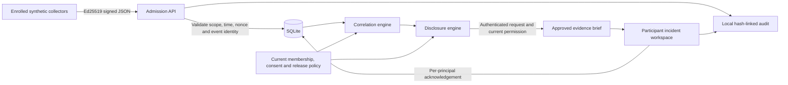
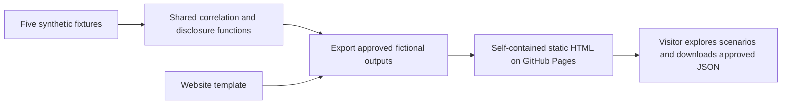
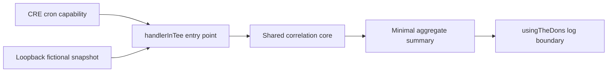

# Architecture and trust boundaries

QuietSignal implements a deterministic correlation/disclosure core, a persistent local pilot, a static public demonstration, and a separately compiled CRE workflow. They share policy logic but have different execution and trust boundaries.

## Persistent local pilot

1. **Admission:** `app/security.ts` signs/verifies a domain-separated message binding workspace, method, exact endpoint, collector, signing time, nonce and raw-body digest. `app/api.ts` applies strict schemas, organization/key scope, membership validity, evidence time/sequence and capacity checks. Collector validity and request age are checked again after reading a streamed body.
2. **Persistence:** `app/store.ts` stores enrolled organizations, public collector keys, hashed access/session tokens, isolated runs, accepted observations, nonce state, incident UUIDs, acknowledgements and audit entries. Foreign keys, transactions, WAL and schema-version checks protect local consistency. Private seed material and the operator access file are separate ignored local files.
3. **Correlation:** `correlation/model.ts` validates the full snapshot, rejects conflicting event identities, excludes ineligible evidence and groups by supplier/version/normalized destination. Distinct enrolled organizations count once per group. Three organizations and two qualifying sequences are required by the current policy.
4. **Disclosure:** `correlation/evidence.ts` validates the full input before filtering, checks recipient eligibility, applies contributor consent and approved supplier/version/domain rules, then recomputes the threshold from permitted contributions. A raw correlation result cannot bypass release policy.
5. **Delivery:** list, detail, acknowledgement and download handlers recompute current release permission. An incident has an opaque UUID; acknowledgements belong to one principal. Participants see approved evidence and their own audit actions. Operator views are explicitly labeled previews of releasable evidence, while separate administration routes expose the trusted registry.

The pilot is loopback-only. Its administrator, process, local database and test-key owner are trusted. Its registered-key signatures are real cryptography over fictional observations; they do not establish truthful host telemetry or independently owned companies.

## Public website

`scripts/export-demo.ts` embeds only the generated approved outputs. It does not export the synthetic roster, raw observations, collector/access material or pilot database. Scenario switching requires no backend or external runtime request. This makes the public demonstration portable, reproducible and useful without exposing the local administrative application. The website's workspace link becomes a local-pilot status anchor in the static export.

The static site does not enforce the authenticated pilot's runtime access controls. It demonstrates fictional outputs to every visitor. Its sample evidence times are fixed when built; the interface explicitly describes the offline simulation.

## CRE workflow

`correlation/workflow.ts` uses the CRE SDK's confidential-handler API and enclave constraints. Configuration permits only the local simulation mode and loopback fixture source. The workflow has no signer, EVM client, receiver, report-writing path or broadcast action.

Its TypeScript and WASM build are validated; handler tests use a mock runtime. Native authenticated CRE simulation and deployed enclave execution remain unvalidated. The workflow does not read pilot SQLite state or deliver participant briefs. Connecting those paths requires an authenticated snapshot boundary and a recipient-specific release path that keeps plaintext briefs out of ordinary DON logs/public reports.

See [the security model](security-model.md), [design decisions](design-decisions.md), [API contract](api.md) and [validation evidence](validation.md).
