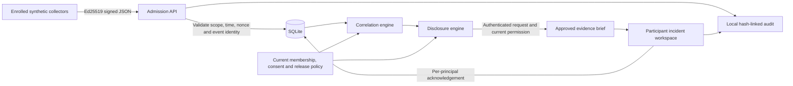
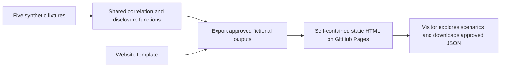
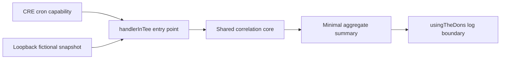

# Architecture and trust boundaries

QuietSignal has one processing pipeline: **scoped observations → authentication/validation → correlation → consent and disclosure checks → an approved evidence brief**.

One shared policy engine supports three execution modes:

| Mode | Purpose | Where it runs |
| --- | --- | --- |
| Public demonstration | Explain policy behavior using five precomputed fictional scenarios | Static HTML on GitHub Pages |
| Local pilot | Exercise signed ingestion, persistent incidents, roles, consent and revocation | One Bun process and one SQLite database on loopback |
| CRE adapter | Express the intended confidential processing boundary and compile/test its interface | Separate WASM workflow; native/deployed execution remains unvalidated |

These are execution boundaries, not independently deployed backend services. The public demo never connects to the private local database. The CRE adapter currently consumes separate fictional fixtures rather than pilot data.

## Persistent local pilot



1. **Admission:** `app/security.ts` signs/verifies a domain-separated message binding workspace, method, exact endpoint, collector, signing time, nonce and raw-body digest. `app/api.ts` applies strict schemas, organization/key scope, membership validity, evidence time/sequence and capacity checks. Collector validity and request age are checked again after reading a streamed body.
2. **Persistence:** `app/store.ts` stores enrolled organizations, public collector keys, hashed access/session tokens, isolated runs, accepted observations, nonce state, incident UUIDs, acknowledgements and audit entries. Foreign keys, transactions, WAL and schema-version checks protect local consistency. Private seed material and the operator access file are separate ignored local files.
3. **Correlation:** `correlation/model.ts` validates the full snapshot, rejects conflicting event identities and duplicate collector enrollment, excludes ineligible evidence and groups by supplier/version/normalized destination. Distinct enrolled organizations count once per group. Three organizations and two qualifying sequences are required by the current policy. Shared defaults live in `correlation/defaults.ts`, separate from fictional fixtures in `demo/fixtures.ts`; a test checks the CRE configuration against those defaults.
4. **Disclosure:** `correlation/evidence.ts` validates the full input before filtering, checks recipient eligibility, applies contributor consent and approved supplier/version/domain rules, then recomputes the threshold from permitted contributions. A raw correlation result cannot bypass release policy. Internal release decisions retain the stable finding tuple; the public projection returns only an approved brief. Each brief's expiry follows its own supporting evidence, source freshness and recipient validity.
5. **Incident delivery:** `app/incidents.ts` owns finding-to-incident matching and recipient projection. It matches stable supplier/version/destination identities rather than reconstructing identities from display labels. `app/api.ts` authenticates/authorizes HTTP requests and delegates incident reads. List, detail, acknowledgement and download handlers recompute current release permission. An incident has an opaque UUID; acknowledgements belong to one principal. Participants see approved evidence and their own audit actions. Operator views are explicitly labeled previews of releasable evidence, while separate administration routes expose the trusted registry.

The pilot is loopback-only. Its administrator, process, local database and test-key owner are trusted. Its registered-key signatures are real cryptography over fictional observations; they do not establish truthful host telemetry or independently owned companies.

## Public website



`demo/scenarios.ts` generates the same fictional result for the HTTP showcase and static export. `scripts/export-demo.ts` delegates to `demo/website.ts`, which fills an explicit JSON data slot and does not rewrite executable JavaScript. It exports no synthetic roster, raw observations, collector/access material or pilot database. Scenario switching requires no backend or external runtime request. The website's workspace link becomes a local-pilot status anchor in the static export.

The static site does not enforce the authenticated pilot's runtime access controls. It demonstrates fictional outputs to every visitor. Its sample evidence times are fixed when built; the interface explicitly describes the offline simulation.

## CRE workflow



`correlation/workflow.ts` uses the CRE SDK's confidential-handler API and enclave constraints. Configuration permits only the local simulation mode and loopback fixture source. The workflow has no signer, EVM client, receiver, report-writing path or broadcast action.

Its TypeScript and WASM build are validated; handler tests use a mock runtime. Native authenticated CRE simulation and deployed enclave execution remain unvalidated. The workflow does not read pilot SQLite state or deliver participant briefs. Connecting those paths requires an authenticated snapshot boundary and a recipient-specific release path that keeps plaintext briefs out of ordinary DON logs/public reports.

When supported authentication is available, keep `bun run dev` running and execute this non-broadcast simulation from the project root:

```sh
cre workflow simulate correlation --target local-simulation --non-interactive --trigger-index 0
```

Do not add `--broadcast`. Native simulation needs the CRE CLI and supported account authentication; it is not a prerequisite for the website, pilot checks or WASM compilation.

## Code boundaries

| Location | Responsibility |
| --- | --- |
| `correlation/` | Pure validation/correlation/disclosure, shared defaults and CRE adapter |
| `app/api.ts` | HTTP authentication, authorization, admission and administrative commands |
| `app/incidents.ts` | Incident recognition, stable identity and recipient-safe projection |
| `app/store.ts` | SQLite persistence and local audit consistency |
| `demo/` | Fictional inputs, shared showcase results and static website rendering |
| `web/` | Public showcase and local operator/participant interfaces |
| `scripts/` | Development server, CLI commands, export and browser-check entry points |

Application/tests and workflow tests use separate TypeScript configurations: the CRE SDK intentionally restricts runtime globals, while the Bun backend needs filesystem and cryptography APIs. Both groups are checked without relaxing the workflow's runtime constraints.

See [the security model](security-model.md), [design decisions](design-decisions.md), [API contract](api.md) and [validation evidence](validation.md).
